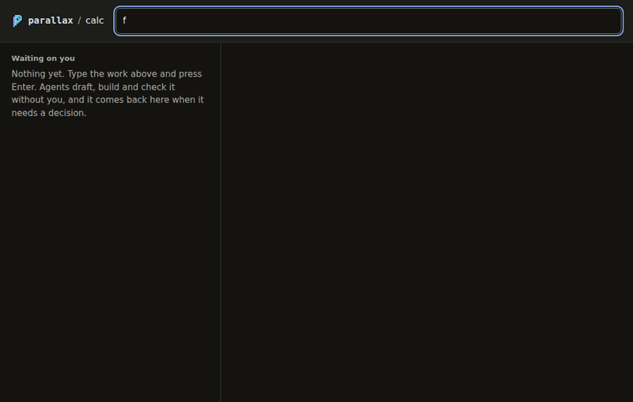
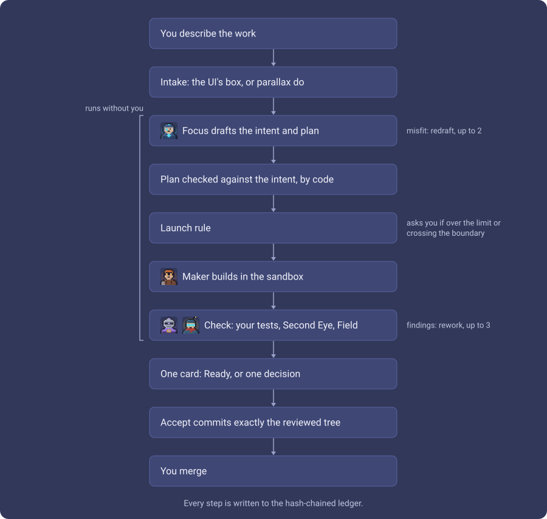
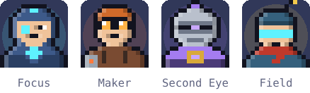

<p align="center">
  <picture>
    <source media="(prefers-color-scheme: dark)" srcset="docs/brand/lockup-animated-dark.svg">
    
  </picture>
</p>

<a href="https://github.com/mpwilso/parallax/actions/workflows/tests.yml"></a>

**Agents do the work. You make the calls.**

AI coding agents build in a locked-down sandbox. You make one decision per task: accept or send back.

Status: a portfolio project, built to show how I design, test and judge an AI tool. In eval run 8e3074, 10 of 11 real open-source fixes passed their maintainers' hidden tests, each Ready with one decision ([docs/evals.md](docs/evals.md#results)).

<p align="center"></p>

<p align="center"><sub>Demo with scripted agents, so it runs in seconds and costs nothing. Real runs are in <a href="docs/ui-runs/">docs/ui-runs/</a>.</sub></p>

**3 min 25 s from request to Ready, $0.92 in agent costs (estimate), 1 decision: accept.** One real task, a one-line README fix, run through the UI. All three real runs, with every screen and cost: [docs/ui-runs/](docs/ui-runs/README.md).

## What it does

<p align="center"></p>

<picture><source media="(prefers-color-scheme: dark)" srcset="docs/brand/party-animated-dark.svg"></picture>

**Focus** drafts the intent and plan. **Reticle** writes tests of what you asked, before the build; Maker can't see or change them. **Maker** builds in the sandbox. **Second Eye** is the blind checker: it gets the goal, the review rules and the change itself, never the plan or the builder's notes, and a test pins that. **Field** is the UI tester, which uses your app in a real browser and leaves tests behind. In the UI a portrait moves while its agent is working.

- **One decision per task, measured, and one way through, tested.** `parallax stats` counts how often each task needed you; the goal is once: accept. Start work from the app or the terminal, or pick it back up, and every way in passes the same checks before an agent runs: your signed approval, a spending cap, a test of the sandbox, an entry in the log. One test proves that for every way in.
- **Every question comes ready to answer:** the options, what each one does, whose call it is and why a person has to make it, and a recommendation written by code, not by a model.
- **What an agent may reach is part of what you approve.** Network access, files outside its workspace and new dependencies are listed in the plan, and the sandbox is tested before every launch. A plan that asks for more never starts without you.
- **Code decides what happens next, not a model.** Every step goes into a tamper-evident log, and every approval is signed with a key the agents can't read.

## Try it

Linux, or Windows through WSL2 ([docs/wsl.md](docs/wsl.md) makes the distro); macOS is untested. You need root for `apt`, Node 22 and a logged-in Claude Code. What each step installs, the AppArmor `sysctl` behind step 1, and installing from a clone: [Setup](docs/using.md#setup).

1. The tools, as root. Apt's Node is too old for the sandbox runtime, so Node comes from NodeSource:
   ```bash
   apt update && apt install -y git bubblewrap socat ripgrep python3 curl ca-certificates
   curl -fsSL https://deb.nodesource.com/setup_22.x | bash - && apt install -y nodejs
   npm install -g @anthropic-ai/sandbox-runtime
   sysctl -w kernel.apparmor_restrict_unprivileged_userns=0   # Ubuntu 24.04 and later; keep it in /etc/sysctl.d/99-parallax.conf
   ```
2. As your user, uv and Claude Code, then log in:
   ```bash
   curl -LsSf https://astral.sh/uv/install.sh | sh
   curl -fsSL https://claude.ai/install.sh | bash
   source ~/.local/bin/env && claude
   ```
3. Parallax itself, from GitHub (the `parallax` on PyPI is an unrelated SSH tool). The latest release is [v0.2.3](https://github.com/mpwilso/parallax/releases/tag/v0.2.3):
   ```bash
   uv tool install "parallax[claude] @ git+https://github.com/mpwilso/parallax@v0.2.3"
   ```
4. `parallax doctor` checks the machine:
   ```
   platform      linux on wsl2                      ok
   sandbox       bubblewrap, socat, srt             ok
   claude login  found                              ok
   build tools   git, uv                            ok
   windows       interop off, path off, drives off  ok
   approval key  ~/.config/parallax/key             ok
   signing key   none: accept commits won't be signed
   repo          not in a git repo: run doctor in your repo to check it too
   ready.
   ```
5. In a git repo you want agents to work on: `parallax init`, then `parallax ui`. Type the task and answer the one card that comes back. Ready means the listed checks passed, not that the code is bug-free. The keys, the terminal commands, merging, Stop, spending, removal and the tests: [docs/using.md](docs/using.md).

## What was measured

- **Evals:** the 11 real fixes in the status line ran in one eval run, each reaching Ready with one decision, $9.68 in all; the one miss, humanize-174, is a requirements gap, below ([run 8e3074](docs/evals.md#results)).
- **Seeded breaks:** against 23 mechanically broken versions of those fixes, Reticle or Second Eye caught 20, with 2 false alarms on the 11 real fixes ([docs/evals.md](docs/evals.md#the-checkers-together)). Those are seeded edits, not the mistakes Maker actually makes.
- **Real runs through the UI:** three tasks on this repo, one or two decisions each, $0.92 to $4.44; $27.71 spent across every attempt, the ones that found bugs included ([docs/ui-runs/](docs/ui-runs/README.md)).

## Limits

- **Second Eye reads the diff and can't run code.** It judges the outcome where the diff shows it, and says what it couldn't see. Reticle's tests do run: a test that passes on the code before the change is dropped, so every kept test was seen failing before the fix.
- **A requirements gap gets past every checker.** When Focus guesses wrong about what was wanted, every check passes the guess, because each one judges the work against that intent (humanize-174 in the evals).
- **One person, one machine.** Several tasks from one request, and a knowledge layer that gives agents project context and past decisions, are planned, not built.

The full list: [docs/using.md](docs/using.md#limits). What it protects and what it can't: [docs/THREAT_MODEL.md](docs/THREAT_MODEL.md).

## How it was built

I designed Parallax and directed its build; Claude Code wrote most of the code under that direction. I reviewed every milestone, and the design notes and real run logs in [docs/](docs/) show the process. How it got here, milestone by milestone: [docs/history.md](docs/history.md). One early task it did on itself, before the hands-free redesign: [docs/example.md](docs/example.md).

## The other tools

This is one of six tools. Three run in order: [Loupe](https://github.com/mpwilso/loupe) writes the story, Parallax builds it in a sandbox and keeps the record, and [ISR](https://github.com/mpwilso/isr) tells the person accepting it what is left to check. Three stand alone: [Polarizer](https://github.com/mpwilso/polarizer) holds an agent's risky tool calls until a person approves them, [Mordecai](https://github.com/mpwilso/mordecai) judges whether a Claude skill helps, and [Max Q](https://github.com/mpwilso/Project-Max-Q) ranks job postings against a profile. Each runs on its own. The three were run in order once, on one change: [ISR's run log](https://github.com/mpwilso/isr/blob/master/docs/run-log.md).

## License

[MIT](LICENSE).
